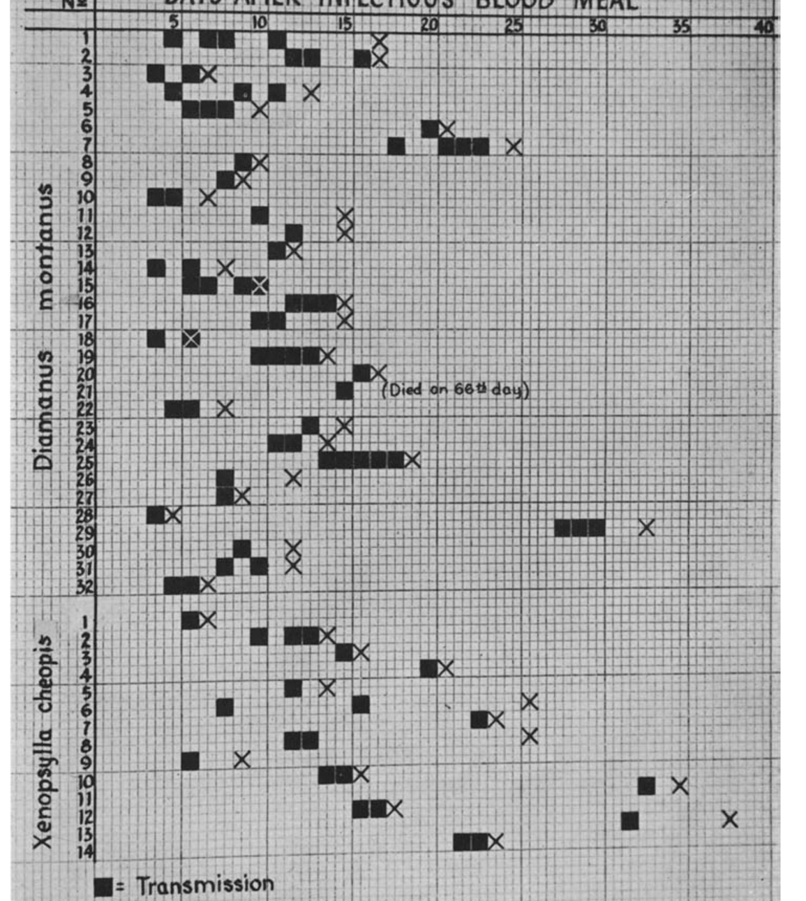

## Purpose

Running notes on primary sources we have read, so that the parameter
tables (`data/*.csv`) can stay terse. Each section records what the
paper measures, what it reports (point values, ranges, uncertainty),
and how that relates to the parameters in `data/param_dict.csv`.

PDFs are in `papers/` (gitignored); figures worth re-reading are in
`pix/`.

**Convention:** a value that is a maximum, or a mean with no dispersion,
is recorded as such. Nothing here is converted into a prior; that
happens in `notes/param_priors.qmd`.

## Keeling & Gilligan: which source goes with which parameter

@keeling2000bubonic Table 1 is the authoritative list, and it is more
specific than the *Nature* paper [@keeling2000metapopulation]. The
caption marks starred parameters as "estimated from either laboratory
experiments or field observations" and numbers the sources 1-6.

| KG parameter | Value (per year) | Source in Table 1 |
|---|---|---|
| `r_R`, `d_R` | 5, 0.2 | 1 = @buckle1994rodent |
| `p` | 0.975 | 2 = @hirst1938plague |
| `g_R` | 0.02 | 2 = @hirst1938plague |
| `K_F` | 3.29-11.17, mean 6.57 | 2 = @hirst1938plague |
| `beta_R` | 4.7 | 3-5 = @wheeler1945sylvatic, @macchiavello1954reservoirs, @hinnebusch1998estimation |
| `d_F` | 10 | 6 = @bacot1915observations |
| `K_R`, `a` | 2500, 0.004 | "fundamental parameters of the model" (no source) |
| `m_R`, `r_F`, `mu_R`, `mu_F`, all human parameters | | "chosen within biologically realistic bounds" |

Two things worth noting:

- The *Nature* Table 1 cites **only** Macchiavello for `beta_R`, where
  *Proc R Soc B* cites all three of Wheeler & Douglas, Macchiavello and
  Hinnebusch et al. The *Proc R Soc B* attribution is the one we follow
  in `data/kg_params.csv`.
- The caption says explicitly that `a` and `K_R` are not estimated from
  data: they are the free parameters that set $R_0$, explored in
  @keeling2000bubonic §6 and Fig. 3b.

## Wheeler & Douglas (1945): vector efficiency

@wheeler1945sylvatic is source 3 for KG's `beta_R`. It is a laboratory
study of four flea species biting white mice, designed to make vector
efficiency a *standardized, comparable* number rather than to estimate
a transmission rate.

### What they define

Vector efficiency is the product of three potentials (their p. 3):

- **infection potential**: fraction of fleas that acquire infection;
- **vector potential**: fraction of infected fleas that become infective
  (i.e. develop a block);
- **transmission potential**: mean number of transmissions per infective
  flea.

The product is the mean number of transmissions per flea offered an
infectious meal.

### What they report (Table 2)

| Species | n | Infection | Vector | Transmission | **Vector efficiency** |
|---|---|---|---|---|---|
| *X. cheopis* | 49 | 0.96 | 0.30 | 1.50 | **0.43** |
| *D. montanus* | 80 | 0.84 | 0.48 | 2.09 | **0.84** |
| *C. felis* | 14 | 0.86 | 0 | 0 | **0** |
| *H. anomalus* | 10 | 0.40 | 0 | 0 | **0** |

*N. fasciatus* was tested only en masse (transmission confirmed, not
quantified).

### Timing, and the limits of what is reported

For *X. cheopis*: mean 16 days to become infective (min 6, max 33);
mean duration of infectivity 4 days (min 1, max 18).
For *D. montanus*: mean pre-infective period 10 days (min 3, max 27);
mean infective period 5 days (min 1, max 51).

Longevity (their Table 4), mean days, fleas kept individually and
offered a mouse daily:

| Species | Infected | Uninfected |
|---|---|---|
| *C. felis* | 12 | 24 |
| *H. anomalus* | 15 | 41+ |
| *X. cheopis* | 20 | 39 |
| *D. montanus* | 11 | 35 |

These are *on-host* lifespans with daily feeding, so they are not
comparable with KG's `d_F`, which is the death rate of free fleas
searching for a host. They do show that infection roughly halves flea
lifespan, which no plague model in our comparison set represents.

**No SD or SE anywhere in the paper.** Means with observed minima and
maxima are all the text gives.

### Chart 1 has the individual data

Chart 1 (p. 8) plots, for each of the 46 infective fleas, every
transmission (filled square) and the day of death (X) against days since
the infectious blood meal, on a one-day grid. So the per-individual data
underlying all four summary statistics *are* recoverable, which would
give SDs and the distribution shapes rather than mean/min/max.

An automated extraction attempt did not reproduce the published summary
statistics (it recovered a pre-infective maximum of 23 days against the
stated 33), so no digitized values are recorded yet. See the TODO entry
under 1a; reading the chart by eye is probably the quicker route.

Note the long right tail already visible in the chart: two *X. cheopis*
transmitted for the first time around days 31-32, against a mean of 16.
A symmetric error model for the extrinsic incubation period would be a
poor fit.

### Relation to `beta_R`

Vector efficiency is a per-flea count of transmissions to mice under
daily feeding. It is **not** a per-year transmission rate, and the paper
contains no quantity in the units of KG's `beta_R`. Whatever KG did to
get 4.7/yr, it is not a number that appears in this paper.

## Hinnebusch, Gage & Schwan (1998): quantifying *Y. pestis* in fleas

@hinnebusch1998estimation is source 5 for KG's `beta_R`. It is
principally a **methods** paper: a competitive quantitative PCR assay to
count *Y. pestis* genomes in individual fleas, validated against colony
counts.

### Epidemiologically relevant numbers

- **Blockage criterion.** 56/58 (96%) of blocked *X. cheopis* contained
  $\ge 10^5$ bacteria and 38/58 (65%) more than $10^6$, so a burden of
  $\ge 10^5$ is proposed as the marker of potential infectivity.
- **Field sample.** 44 *Oropsylla hirsuta* collected from a
  prairie-dog colony in Larimer County, Colorado in June 1994, after an
  epizootic had exterminated the colony: 21/44 (48%) PCR-positive, but
  17 of those 21 held fewer than $10^3$ bacteria and none met the
  $10^5$ blockage criterion. One flea at $\approx 2\times10^4$ may have
  been incipiently blocked, i.e. under 2% of the sample.
- **Extrinsic incubation**, quoted from Eskey & Haas (1940), not measured
  here: mean time from ingestion to blockage 21 days for *X. cheopis*
  and 102 days for *O. hirsuta*; a bacteraemic guinea pig infected 28%
  of *O. hirsuta* and 38% of *X. cheopis*.

### Uncertainty

The only dispersion reported is for assay calibration (standard-curve
$R^2$ mean 0.98, SD 0.02 over 30 runs; slopes mean 0.93, SD 0.14). These
describe the measurement method, not any epidemiological parameter, so
they are not usable for priors.

Again, **no transmission rate in KG's units appears in this paper**, and
the field prevalence is for a prairie-dog flea at the tail end of an
epizootic, not an urban rat flea.

## Where KG's `beta_R` = 4.7/yr comes from

Taking the three cited sources together:

- @wheeler1945sylvatic gives transmissions per flea (0.43 for
  *X. cheopis*) in laboratory mice;
- @hinnebusch1998estimation gives the prevalence of infection and
  blockage in a field flea population, plus extrinsic incubation periods;
- @macchiavello1954reservoirs is a 12-part serial review that we have not
  obtained (see TODO 1a).

None of the two we have read states a flea-to-rat transmission rate.
`beta_R` = 4.7/yr therefore appears to be KG's own synthesis rather than
a value taken from any of them, and the three citations support the
*ingredients* (how often an infected flea transmits, how many fleas are
infective) rather than the number itself.

This matters for priors: the TODO list has `beta_r` under "transmission
rates set only by assumed ranges plus KG's value". That is the right
classification, and the reason is now documented rather than inferred.
A prior built from the ingredients (vector efficiency $\times$ blockage
prevalence $\times$ biting rate) would have a defensible empirical basis,
where one centred on 4.7/yr does not.

## Still to obtain

- @macchiavello1954reservoirs: 12-part serial in *J. Trop. Med. Hyg.*
  57, almost certainly never digitized; KG cite pp. 1-68. Needs
  interlibrary loan.
- @hirst1938plague: print only at McMaster (see TODO 1a). Source for
  `p`, `g_R` and `K_F` -- three of the six starred parameters, so the
  highest-value remaining item.
- @buckle1994rodent: book; check for a McMaster e-book of the 1994 or
  2015 edition. Source for `r_R` and `d_R`.

## References
